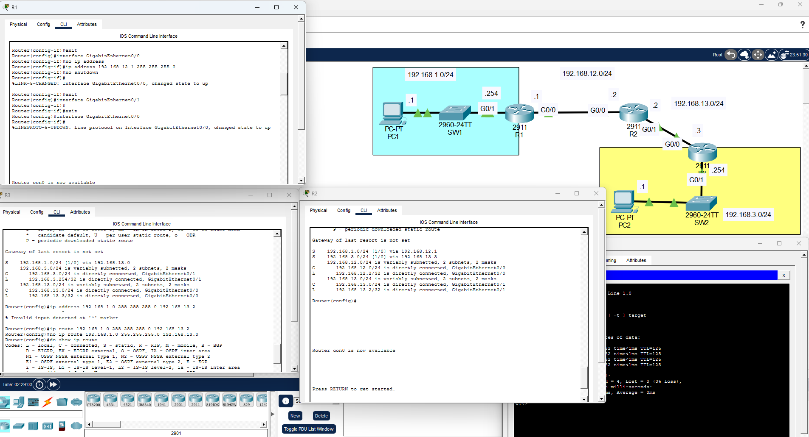

# Day 11 – Static Routing Lab

## Overview
In this lab, I configured static routes across three Cisco routers to establish communication between two separate LANs using Cisco Packet Tracer.

The objective was to manually configure IP addressing, default gateways, and static routes to allow PC1 to successfully communicate with PC2.

## Network Topology



### IP Addressing

| Device | Interface | IP Address |
|--------|-----------|------------|
| PC1 | Ethernet | 192.168.1.1/24 |
| R1 | G0/1 | 192.168.1.254/24 |
| R1 | G0/0 | 192.168.12.1/24 |
| R2 | G0/0 | 192.168.12.2/24 |
| R2 | G0/1 | 192.168.13.2/24 |
| R3 | G0/0 | 192.168.13.3/24 |
| R3 | G0/1 | 192.168.3.254/24 |
| PC2 | Ethernet | 192.168.3.1/24 |

**Default Gateways:**
- PC1: 192.168.1.254
- PC2: 192.168.3.254

## Configuration

### 1. Interface Configuration
- Assigned IP addresses to all router interfaces.
- Enabled router interfaces using `no shutdown`.
- Configured static IP addresses and default gateways on both PCs.

### 2. Static Routing

Configured static routes to allow communication between networks that were not directly connected.

**R1:**
```cisco
ip route 192.168.3.0 255.255.255.0 192.168.12.2
```

**R2:**
```cisco
ip route 192.168.1.0 255.255.255.0 192.168.12.1
ip route 192.168.3.0 255.255.255.0 192.168.13.3
```

**R3:**
```cisco
ip route 192.168.1.0 255.255.255.0 192.168.13.2
```

## Verification

Used the following commands to verify routing and connectivity:

- `show ip route` – Verified static and directly connected routes.
- `ping` – Tested connectivity between PC1 and PC2.

**Result:** Successfully established communication between both LANs, with the ping test returning 0% packet loss.

## Troubleshooting

Initially, I had difficulty identifying the correct next-hop IP address when configuring static routes. I mistakenly used a destination network address instead of the IP address of the neighboring router.

After reviewing the `ip route` command syntax, I corrected the next-hop addresses and verified the routing tables.

This helped reinforce my understanding of how routers forward packets toward remote networks.

## Key Takeaways

- Configured static IPv4 routes using Cisco IOS.
- Learned how to identify the correct next-hop IP address.
- Understood the difference between directly connected and remote networks.
- Practiced interpreting routing tables using `show ip route`.
- Verified end-to-end network connectivity.
- Gained experience troubleshooting static routing configurations.

## Tools Used

- Cisco Packet Tracer
- Cisco IOS
- Static IPv4 Routing

## Reference

Lab based on Jeremy's IT Lab CCNA course. Configurations and troubleshooting were completed independently as part of my CCNA studies.
