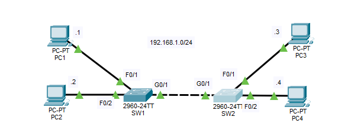

# CCNA Lab 06 — Ethernet LAN Switching

## Overview
This lab explores Ethernet LAN switching using Cisco Packet Tracer. The objective was to understand how switches learn MAC addresses, forward Ethernet frames, and handle ARP requests and ICMP traffic across multiple interconnected switches.

## Tools
- Cisco Packet Tracer
- Cisco Catalyst 2960 Switches
- End Devices (PCs)
- Cisco IOS CLI

## What I Did
- Built a LAN topology consisting of two Cisco 2960 switches and four PCs.
- Configured four PCs with IPv4 addresses within the `192.168.1.0/24` network.
- Verified connectivity between end devices using ICMP ping.
- Used Packet Tracer Simulation Mode to observe network traffic.
- Examined ARP requests and replies during device communication.
- Generated network traffic to populate the switches' MAC address tables.
- Used `show mac address-table` to identify dynamically learned MAC addresses and their associated switch ports.
- Cleared dynamically learned MAC addresses using `clear mac address-table dynamic`.

## What I Learned
- How switches dynamically learn MAC addresses by examining the source MAC address of incoming Ethernet frames.
- The difference between unicast and broadcast traffic.
- How switches flood frames when the destination MAC address is unknown.
- How ARP resolves IPv4 addresses into MAC addresses.
- How switches use MAC address tables to forward Ethernet frames through the appropriate ports.
- How to inspect and manage MAC address tables using Cisco IOS commands.

## Network Topology

## Files
| File | Description |
|---|---|
| `lab06.pkt` | Cisco Packet Tracer lab file |
| `topology.png` | Network topology screenshot |
